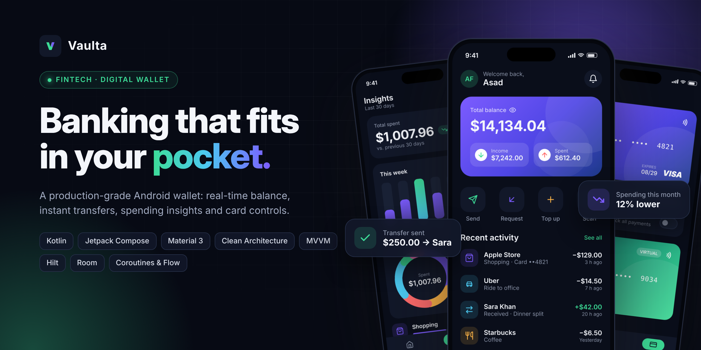
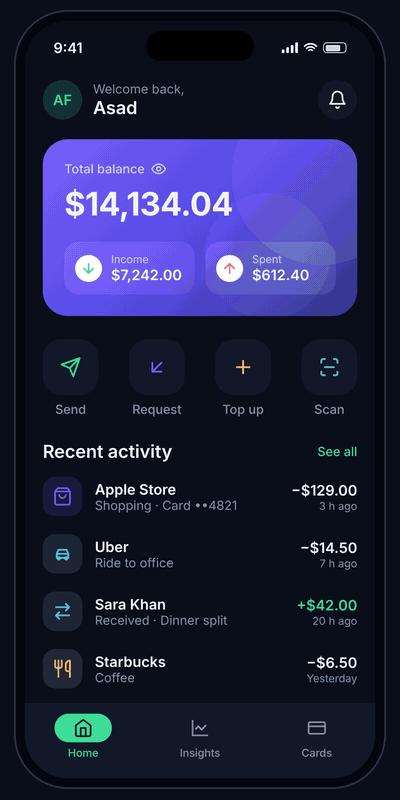
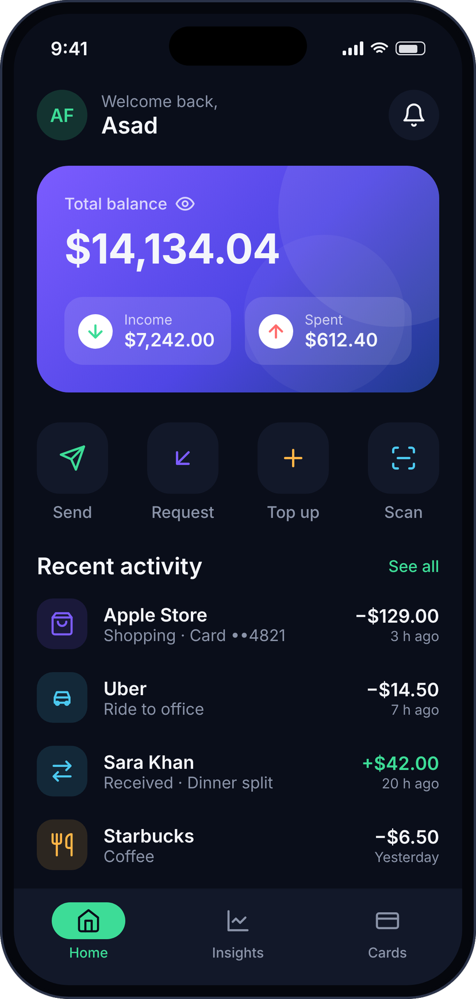
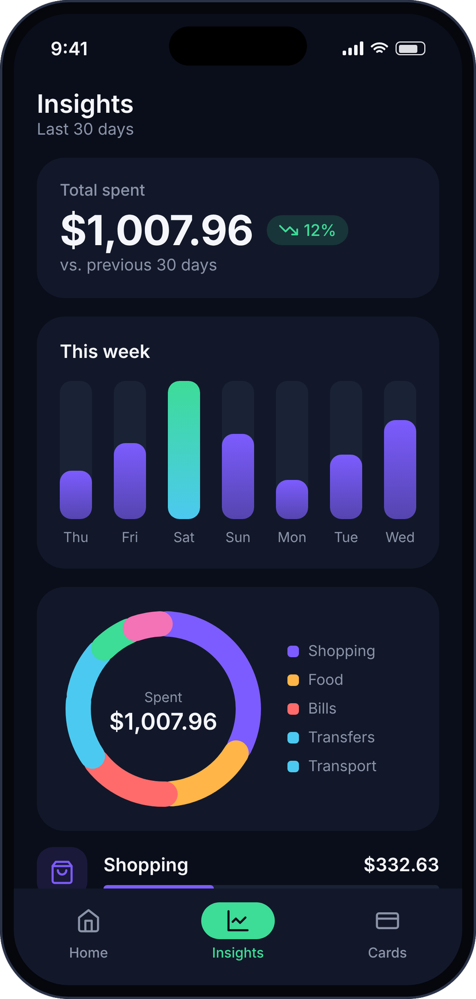
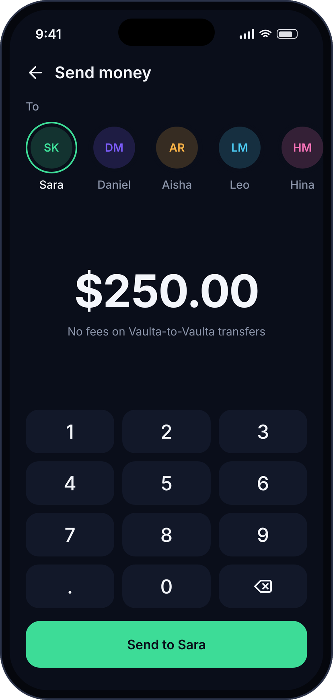
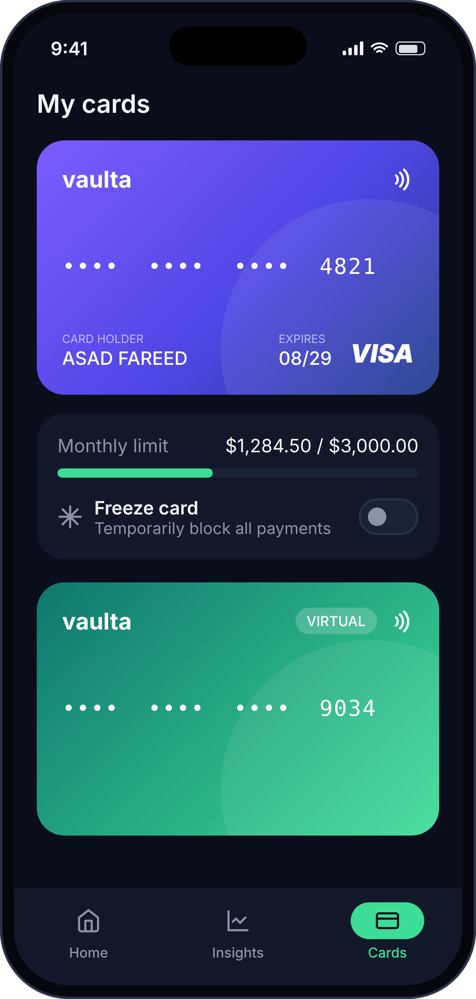

<p align="center">
  
</p>

<h1 align="center">Vaulta: Digital Wallet for Android</h1>

<p align="center">
  
  
  
  
  
</p>

<p align="center">
  <a href="https://github.com/asadfareed777/vaulta-wallet/releases/latest">
    
  </a>
  &nbsp;
  <a href="https://github.com/asadfareed777/vaulta-wallet/actions/workflows/android.yml">
    
  </a>
</p>

Vaulta is a fintech wallet app built to show how a production Android codebase is organised. It covers a real-time balance dashboard, peer-to-peer transfers with validation, spending analytics drawn with custom Compose charts, and card controls. The UI is built entirely in Jetpack Compose on a Clean Architecture core with unit tests.

## Demo

<p align="center"></p>

## Screens

| Home | Insights | Send money | Cards |
|:---:|:---:|:---:|:---:|
|  |  |  |  |

## Features

- **Live dashboard:** the balance and monthly income/spend are derived reactively from the transaction ledger (Room + `Flow`). A privacy toggle hides the balance.
- **P2P transfers:** contact picker, a custom numeric keypad with input sanitising, and domain-level validation (invalid amount, per-transfer limit, insufficient funds). The success state is animated.
- **Spending insights:** a 30-day total with change against the previous period, an animated weekly bar chart and a category donut chart, all drawn with Compose `Canvas` and no chart library.
- **Card management:** physical and virtual cards drawn at the ISO ID-1 ratio, a monthly limit tracker and a freeze/unfreeze toggle.
- **Money-safe math:** every amount is stored in minor units (`Long` cents), so balances never pick up floating-point rounding errors.

## Architecture

```
app/src/main/java/com/asadfareed/vaulta
├── core/            # design system (theme, colors) & formatters
├── domain/          # pure Kotlin: models, repository contract, use cases
│   ├── model/
│   ├── repository/WalletRepository.kt
│   └── usecase/     # GetDashboard, GetSpendingInsights, SendMoney, Cards
├── data/            # Room database, mappers, repository implementation
├── di/              # Hilt modules (database, clock, dispatchers, bindings)
└── presentation/    # Compose screens + ViewModels (UDF with StateFlow)
    ├── home/  insights/  transfer/  cards/
    └── navigation/
```

- **Unidirectional data flow:** each ViewModel exposes a single immutable `StateFlow<UiState>`, and screens are stateless composables that receive state and lambdas, which keeps them previewable and testable.
- **The domain layer has no Android imports.** Use cases depend only on the `WalletRepository` interface and an injected `java.time.Clock`, so time-based logic is deterministic in tests.
- **Data layer:** Room is the single source of truth, and seeding is idempotent behind a `Mutex`. The repository is the only place that knows about entities.

## Tech stack

| Layer | Libraries |
|---|---|
| UI | Jetpack Compose, Material 3, Navigation Compose, Compose animations, Canvas |
| State | ViewModel, `StateFlow`, `collectAsStateWithLifecycle` |
| DI | Hilt (+ KSP) |
| Persistence | Room (KSP, exported schemas) |
| Async | Kotlin Coroutines & Flow |
| Testing | JUnit 4, Truth, kotlinx-coroutines-test, fake repository |
| CI | GitHub Actions: unit tests + debug APK artifact |

## Getting started

```bash
git clone https://github.com/asadfareed777/vaulta-wallet.git
cd vaulta-wallet
./gradlew assembleDebug      # build
./gradlew testDebugUnitTest  # run unit tests
```

Open the project in Android Studio (Ladybug or newer, JDK 17) and run the `app` configuration. Demo data is seeded on first launch.

## Tests

Business rules are covered at the use-case level:

- `SendMoneyUseCaseTest` covers successful debits, invalid amounts, insufficient funds, the per-transfer limit and the note fallback.
- `SpendingInsightsUseCaseTest` covers category grouping and ordering, change against the previous period, the 7-day series and month-scoped dashboard totals.

## Roadmap

- Biometric authentication for transfers (BiometricPrompt)
- Remote data source (Retrofit) with offline-first sync
- QR pay and scan, plus request-money flow
- Baseline profiles and macrobenchmarks

## License

MIT. See [LICENSE](LICENSE).

---

<p align="center">Built by <a href="https://github.com/asadfareed777"><b>Asad Fareed</b></a>, Senior Android & Flutter Engineer</p>
